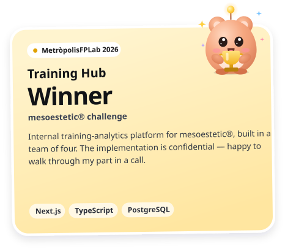
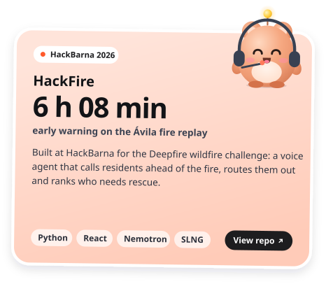
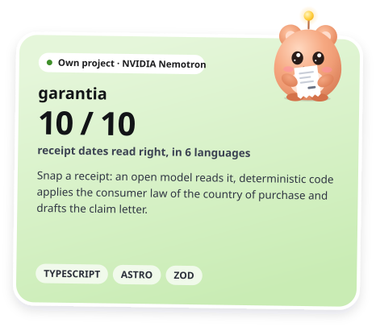
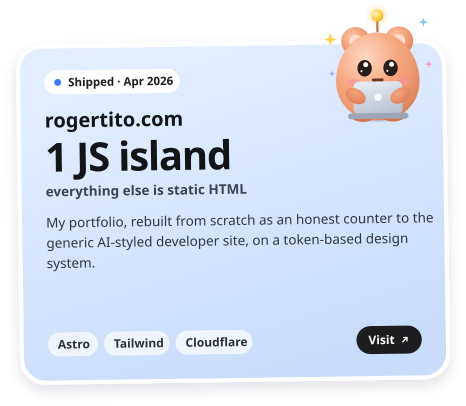
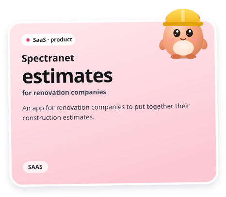
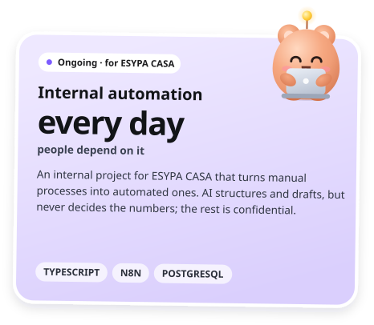

<!-- Generated by assets/gen_cards.py from rogertito.com/profile.json — edit the portfolio, not this file. -->

  <a href="https://rogertito.com/en/"><b>Portfolio</b></a>
  &nbsp;&nbsp;·&nbsp;&nbsp;
  <a href="https://www.linkedin.com/in/roger-tito-farez-035ab626b/"><b>LinkedIn</b></a>
  &nbsp;&nbsp;·&nbsp;&nbsp;
  <a href="mailto:crtitofarez@gmail.com"><b>crtitofarez@gmail.com</b></a>

<picture>
  <source media="(prefers-color-scheme: dark)" srcset="assets/section-experience-dark.svg">
  <source media="(prefers-color-scheme: light)" srcset="assets/section-experience-light.svg">
  
</picture>

<picture>
  <source media="(prefers-color-scheme: dark)" srcset="assets/section-work-dark.svg">
  <source media="(prefers-color-scheme: light)" srcset="assets/section-work-light.svg">
  
</picture>

  
  
   
  
  
   
  
  

<picture>
  <source media="(prefers-color-scheme: dark)" srcset="assets/section-ai-dark.svg">
  <source media="(prefers-color-scheme: light)" srcset="assets/section-ai-light.svg">
  
</picture>

<picture>
  <source media="(prefers-color-scheme: dark)" srcset="assets/section-stack-dark.svg">
  <source media="(prefers-color-scheme: light)" srcset="assets/section-stack-light.svg">
  
</picture>

<picture>
  <source media="(prefers-color-scheme: dark)" srcset="assets/section-about-dark.svg">
  <source media="(prefers-color-scheme: light)" srcset="assets/section-about-light.svg">
  
</picture>

**Building and testing software that people already use every day.**

I started programming well before the syllabus got there: while class was on the theory, I had already broken and fixed the practical at home. So I read the actual documentation, try things, and take nothing as good until I’ve seen it run.

Today I’m in my second year of DAW while working in three places: full-stack at mesoestetic®, the internal app at ESYPA CASA, and QA at PROVEN.

The model writes roughly 90% of the keystrokes. The other 10% is the job: scoping the problem, deciding what’s worth shipping, debugging what the model got wrong, and understanding every line that ends up in main.

based in **Barcelona, Spain** · speaks **Català · Español · English** · works **Remote · hybrid in BCN**

**What I can do for you**

- **A fast site that’s ready to sell** — As fast as this very site, findable on Google, and with a form whose messages actually arrive where they should.
- **Automate repetitive tasks with AI** — That manual process you run every week, turned into something that runs on its own and tells you when something doesn’t add up.
- **Testing that prevents production surprises** — Every release goes through the scenarios your customers really use before it reaches them.

<picture>
  <source media="(prefers-color-scheme: dark)" srcset="assets/section-contact-dark.svg">
  <source media="(prefers-color-scheme: light)" srcset="assets/section-contact-light.svg">
  
</picture>

Kept in sync with <a href="https://rogertito.com">rogertito.com</a>: <a href="assets/gen_cards.py"><code>assets/gen_cards.py</code></a> reads the site's <code>profile.json</code> every day and redraws these cards.
