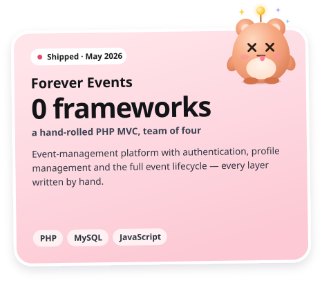
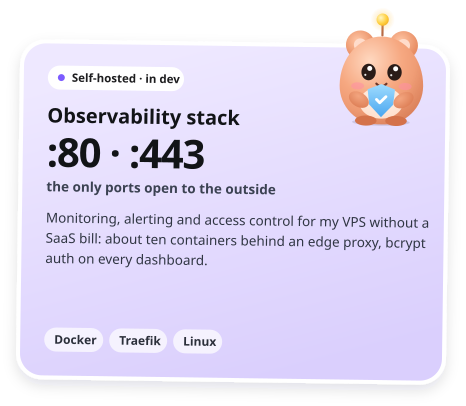

<!-- Generated by assets/gen_cards.py — edit the data there and re-run, not this file. -->

  <a href="https://rogertito.com"><b>Portfolio</b></a>
  &nbsp;&nbsp;·&nbsp;&nbsp;
  <a href="https://www.linkedin.com/in/roger-tito-farez-035ab626b/"><b>LinkedIn</b></a>
  &nbsp;&nbsp;·&nbsp;&nbsp;
  <a href="mailto:crtitofarez@gmail.com"><b>crtitofarez@gmail.com</b></a>

<picture>
  <source media="(prefers-color-scheme: dark)" srcset="assets/section-about-dark.svg">
  <source media="(prefers-color-scheme: light)" srcset="assets/section-about-light.svg">
  
</picture>

I build internal tools and workflow automations with **Claude in the loop** — and I treat AI as a tool to supervise, not a shortcut to skip thinking.

The model writes roughly 90% of the keystrokes. The remaining 10% is where the work actually is — scoping the problem, choosing what's worth shipping, debugging what the model got wrong, and making sure I still understand every line that ends up in `main`.

Second year of DAW in Barcelona (2025–2027). Coursework fundamentals are done **deliberately AI-free**: if I can't write it myself, I don't claim it. Most repositories are private while in development; I'm happy to walk through any of them line by line in a call.

<picture>
  <source media="(prefers-color-scheme: dark)" srcset="assets/section-experience-dark.svg">
  <source media="(prefers-color-scheme: light)" srcset="assets/section-experience-light.svg">
  
</picture>

<picture>
  <source media="(prefers-color-scheme: dark)" srcset="assets/section-work-dark.svg">
  <source media="(prefers-color-scheme: light)" srcset="assets/section-work-light.svg">
  
</picture>

  
  
   
  
  
   
  
  

<picture>
  <source media="(prefers-color-scheme: dark)" srcset="assets/section-ai-dark.svg">
  <source media="(prefers-color-scheme: light)" srcset="assets/section-ai-light.svg">
  
</picture>

<picture>
  <source media="(prefers-color-scheme: dark)" srcset="assets/section-stack-dark.svg">
  <source media="(prefers-color-scheme: light)" srcset="assets/section-stack-light.svg">
  
</picture>

<picture>
  <source media="(prefers-color-scheme: dark)" srcset="assets/section-contact-dark.svg">
  <source media="(prefers-color-scheme: light)" srcset="assets/section-contact-light.svg">
  
</picture>

Cards generated by <a href="assets/gen_cards.py"><code>assets/gen_cards.py</code></a> — the data is the source of truth, the layout is computed.
